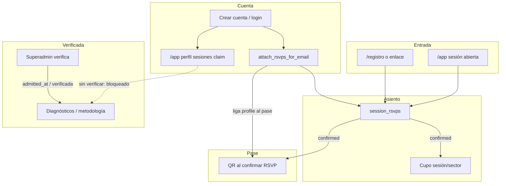

# Asistencia y cuenta estilo Luma — plan de reestructuración

> **For agentic workers:** implementar task-by-task. Cada archivo de código ≤ 90 líneas.

**Goal:** Separar **asiento** (RSVP), **cuenta** (login/`/app`) y **cuenta verificada** (superadmin; desbloquea diagnósticos). Al crear cuenta, enganchar RSVPs. Sin “crea cuenta para el pase”.

**Architecture:** `session_rsvps` = lugar. Cupo/conversiones leen RSVPs `confirmed`. CRM/org = atribución, no gate de cupo. QR al confirmar sin cuenta. **`companies.admitted_at` (u homónimo “verificada”)** = verificación de cuenta por superadmin para diagnóstico — **no** es el cupo del evento.

**Tech stack:** Next.js App Router, Supabase SQL/RPC, Vitest, shadcn Alert/toast.

---

## Análisis de impacto (qué cambia y por qué)

### Invariantes que mueren

| Hoy | Luma |
|---|---|
| Sin cuenta onboarded no hay asiento | RSVP anónimo confirma y baja cupo |
| Admin/org “aceptar” baja cupo | Confirmación de RSVP baja cupo |
| 1 company ≤ 1 `session_id` | N RSVPs por email / N sesiones |
| 1 `public_registrations` por email (global) | Unique `(email, session_id)` |
| 1 pass / profile (exige cuenta) | 1 pass / RSVP (QR al confirmar, con o sin cuenta) |
| Conversion org = CRM aceptado + company | Conversion = RSVP confirmed (+ atribución org) |
| `awaitingApproval` bloquea producto | RSVP ya resolvió el lugar; cuenta es opcional |

### Por superficie

**1. Núcleo cupo** — `sector_occupied_ids`, `sector_is_full`, `sector_pace`, `attendance_cancellations`, `my_attendance_state`  
Hoy exigen empresa + onboarding + `admitted_at`/CRM. Deben contar RSVPs `confirmed` por `session_id` (y sector si hay quotas). Cancelación por sesión.

**2. Registro público** — `/registro`, `public_registrations`, `accept_public_registration`, pour, `RegistroDone`  
Hoy el form no baja cupo; accept crea auth+company+password. Luma: submit → RSVP (pending o confirmed según regla); accept **confirma asiento** sin inventar password; done **sin** CTA fuerte a `/crear-cuenta`.

**3. Crear cuenta / onboarding** — `/crear-cuenta`, signup, pour, `attribute_link_signup`  
Pasa a: crear acceso a la app + **attach RSVPs del email**. No es el paso del pase.

**4. CRM org + admin** — `approve_link_signup`, status `cargado→confirmo→registrado`, pases CRM  
Deja de ser el momento del cupo. Sigue siendo embudo de seguimiento / llegada. Atribución de RSVP al organismo vía token.

**5. Organismos** — copy link, home conversions, sector pace  
Conversiones deben contar RSVPs confirmed del enlace/sesión, no solo CRM+company. Pace por sesión del link.

**6. Tablero admin** — cupos KPIs, ocupados/pendientes, omitidos, logos  
“Ocupados” = RSVP confirmed. “Sin cuenta” = métrica aparte. Filtro por sesión sobre RSVPs.

**7. Mail / pases / mesa** — outbox, `passes`, arrivals  
Al **confirmar** RSVP: correo con **QR del pase** (sin cuenta). `passes` pasa a anclarse a `rsvp_id` (+ `session_id`); `profile_id` nullable hasta attach. Mesa escanea ese QR. Deuda `docs/deuda-tecnica-sesion-del-pase.md` se resuelve aquí.

**8. `/app`** — sesiones, attendance label, Unirme  
Claim por sesión; label por RSVP adjunto; multi-sesión.

**9. Empresas admin** — `approve_external_signup`, path pending  
Moderación de cuenta ≠ cupo. Redefinir o deprecar como gate de asiento.

---

## Decisiones fijas (no reabrir en implementación)

1. RSVP confirmed **descuenta cupo** (pending no, salvo hold explícito — no en v1).
2. Multi-sesión libre con el mismo email/cuenta.
3. Cuenta opcional; attach al signup/login con company.
4. **Al confirmar lugar → emitir QR de inmediato** (pase anclado al RSVP; no requiere `auth.users`).
5. Disruptors sin filas de cupo sectorial → tope `capacity_max`.
6. Con filas en `session_sector_quotas` → tope por sector en esa sesión.
7. `companies.session_id` = origen de alta (opcional); **no** inventario de asientos.
8. CRM “aceptar” ya no llama `sector_is_full` como gate principal (compat: no-op si RSVP ya confirmed).
9. **No se borra legacy:** no `DROP` de `public_registrations`, `companies`, `crm_*`, `passes`, `admitted_at`, ni perfiles. Se **añade** `session_rsvps` + backfill; lecturas nuevas prefieren RSVP; tablas viejas quedan hasta migrar lecturas.
10. **Tres capas (Yamil):** RSVP ≠ cuenta ≠ verificación. Copy UI: **verificada** (no “aprobada”). Crear cuenta y entrar al sistema es libre tras onboarding; **diagnósticos / metodología / producto analítico** exigen verificación del superadmin (`admitted_at` reutilizado o renombrado en UI).
11. Verificación **no** bloquea: login, perfil, empresa, listado de sesiones, apartar/claim, ver pase. **Sí** bloquea: metodología/diagnóstico (y lo que se liste en Task 15).

---

## Garantías de legacy (no perder información)

| Dato actual | Qué pasa |
|---|---|
| `auth.users` / `profiles` / `companies` | Intactos. Nadie se recrea ni se apaga. |
| `admitted_at`, `sector_source` | Se conservan; dejan de ser la única fuente de cupo. |
| `companies.session_id` | Se conserva como origen; no se limpia en masa. |
| `public_registrations` | Se conserva; se **copia** a RSVPs. No delete en v1. |
| CRM contactos / eventos / status | Intactos; el embudo sigue. |
| `passes` / outbox / arrivals existentes | Se conservan; se les añade `rsvp_id`/`session_id` cuando se pueda mapear; filas viejas sin eso siguen legibles (“Sin sesión” ok). |
| `link_copies` / `link_opens` | Intactos. |
| Cancelaciones de asistencia | Se migran a por-sesión o se backfillean a la sesión conocida; no se pierden motivos. |

**Regla de deploy:** primero migrar + backfill + verificar conteos (registros ≈ RSVPs, admitidos ≈ confirmed). Solo después cambiar lecturas de cupo/UI. Si un conteo no cuadra, no se apaga el camino viejo.

**Verificación Task 2 (obligatoria antes de Task 3 en prod):**

- [x] `count(public_registrations completed)` ≤ `count(session_rsvps)` mapeados (+ explicar huérfanos).
- [x] `count(companies admitted)` vs RSVPs confirmed ligados (diff documentado). *(~101 = 101)*
- [ ] Spot-check 5 emails conocidos (p.ej. cuentas de prueba Disruptors/Arranque).

---

## Diagrama

---

## Task 0 — Spec corta + matriz de casos

**Files:** `docs/superpowers/specs/2026-11-22-asistencia-cuenta-luma-design.md`

- [x] Documentar matriz (nuevo, email-con-cuenta, logueado, enlace, cupo lleno, multi-evento, cancelar, attach).
- [x] Definir estados RSVP: `pending` | `confirmed` | `cancelled`.
- [x] Un solo mail de confirmación incluye el **QR del pase** (no esperar cuenta). Reenviar = mismo pase del RSVP.

---

## Task 1 — Tabla `session_rsvps` + RLS

**Files:**
- Create: `supabase/migrations/YYYYMMDDHHMMSS_session_rsvps.sql`

- [x] Columnas: `id`, `session_id`, `email` (citext/lower), `status`, `sector_id` nullable, `sector_slug`, `full_name`, `company_name`, `invite_token`, `organization_id` nullable, `profile_id` nullable, `company_id` nullable, `source`, `confirmed_at`, `cancelled_at`, timestamps.
- [x] Unique `(session_id, lower(email))`.
- [x] RLS: dueño por `profile_id = auth.uid()`; superadmin todo; insert público solo vía RPC.
- [x] Apply migration remota.

---

## Task 2 — Backfill desde datos actuales

**Files:** misma migración o `…_session_rsvps_backfill.sql`

- [x] De `public_registrations` completed → RSVP por `session_id` (`pending` si no poured/accepted; `confirmed` si poured o accept histórico).
- [x] De companies con `admitted_at` + `session_id` → RSVP confirmed ligado.
- [x] Companies admitted + `session_id` null → RSVP Arranque si existe slug.
- [x] Test SQL o script de conteos (no inventar emails). *(conteo remoto: ~101 confirmed ≈ admitidos)*

---

## Task 3 — Cupo por sesión sobre RSVPs

**Files:**
- Create/replace: migration `session_rsvp_capacity.sql`
- Modify tests: `src/lib/cupo/sector-quota-sql.test.ts`, `seat-rules.test.ts`

- [x] `private.session_confirmed_count(session_id, sector_id nullable)`.
- [x] `private.session_is_full(session_id, sector_id nullable)` — con quotas usa sector; sin quotas usa `capacity_max`.
- [x] Reemplazar usos de `sector_is_full` en accept/approve por variante con `session_id`. *(confirm_registration_rsvp + approve_link_signup)*
- [x] Mantener wrappers legacy solo si hacen falta para no romper deploy a medias (marcar deprecated).

---

## Task 4 — RPC `upsert_public_rsvp` + wire `/registro`

**Files:**
- Migration RPC
- Modify: `src/app/registro/actions.ts`, form/done
- Tests: registro actions / SQL

- [x] Submit crea/actualiza RSVP `pending` (vía `sync_public_registration_rsvp`).
- [x] Default: **registro público → `pending`; admin “Confirmar lugar” → `confirmed` + descuenta cupo**. Claim `/app` → `confirmed` con historial.
- [x] Unique email+session: idempotente.
- [x] Dual-write: sigue escribiendo `public_registrations` + sync a `session_rsvps`. **No drop**.

---

## Task 5 — Admin registros = confirmar RSVP (no crear cuenta)

**Files:**
- Modify: `accept_public_registration` / nuevo `confirm_session_rsvp`
- Modify: `src/app/api/admin/registros/[id]/aceptar/route.ts`, UI accept
- Modify: list/map registros

- [x] Botón “Confirmar lugar”: `pending` → `confirmed`, chequea cupo, **genera QR + mail con pase**.
- [x] Si email ya tiene `company`/`profile`: attach `profile_id`/`company_id` al RSVP; **no** raise `ya tiene cuenta`.
- [x] Si no hay cuenta: **no** crear `auth.users` ni password; el pase vive en el RSVP.
- [x] Copy UI: “Confirmar lugar” / “Reenviar pase”; no “Aceptar = crear cuenta”.
- [x] Tests: route SQL/UI mínimos (`confirm-rsvp-sql`, `aceptar/route.test`).

---

## Task 6 — UX anti-confusión registro / crear-cuenta

**Files:**
- Modify: `src/app/registro/registro-done.tsx`, `page.tsx`
- Modify: leads landing Disruptors si aplica

- [x] Done: sin CTA primario a `/crear-cuenta`; copy de pase por correo.
- [x] Link secundario: “¿Quieres el diagnóstico? Crea acceso / inicia sesión.”
- [x] Si email ya registrado en auth al submit: `email_has_account` + Alert “Inicia sesión…”.

---

## Task 7 — Attach al signup / login

**Files:**
- Migration: `attach_rsvps_for_email`
- Modify: `src/lib/auth/signup-empresario.ts`, `pour.ts`, `complete-empresario.ts`

- [x] Tras crear company (onboarding): RPC liga RSVPs del email a profile/company.
- [x] **No re-emite QR** al attach si ya hay `rsvp_passes`; solo liga profile.
- [x] Si RSVP confirmed sin pase: `emitMissingRsvpPasses` / `deliverRsvpPass` una vez.
- [x] Pour legacy: `syncAttachedRsvps` también desde `pour.ts`.

---

## Task 8 — Claim desde `/app`

**Files:**
- Migration: `claim_session_seat`
- Modify: `session-attendance.ts`, `[slug]/page.tsx`, action + toast
- Tests

- [x] Requisitos: sesión `is_current` + empresa (claim ya no exige `admitted_at`).
- [x] Insert RSVP confirmed + cupo; multi-sesión OK.
- [x] UI: botón “Apartar lugar” / estado “Ya tienes lugar” / cupo lleno (toast).

---

## Task 9 — Cancelación por sesión

**Files:**
- Migration: alterar `attendance_cancellations` o cancel en `session_rsvps`
- Modify: `cancel_my_attendance`, attendance-slot, onboarding

- [x] Cancelar libera cupo de **esa** sesión (`cancel_session_rsvp`).
- [x] Otras sesiones intactas.
- [x] Estado por RSVP de la sesión de la empresa / onboarding.
- [x] UI cancel en `/app/sesiones/[slug]`.

---

## Task 10 — CRM: desacoplar cupo

**Files:**
- Modify: `approve_link_signup` SQL
- Modify: `src/lib/crm-actions.ts`, admin CRM route
- Tests: link-acceptance

- [x] Approve CRM: si ya hay RSVP confirmed, solo avanza embudo; no bloquea por cupo de nuevo.
- [x] Si no hay RSVP: crear/confirm RSVP al aprobar **y** chequear `session_is_full`.
- [x] UI copy: “Confirmar enlace” / “Aceptar en lista”.

---

## Task 11 — Atribución organismo en RSVP

**Files:**
- Modify: `attribute_link_signup` o nuevo `attribute_rsvp_invite`
- Modify: copy-link / registro con `invitacion`

- [x] RSVP guarda `organization_id` / `invite_token` al registrarse con enlace.
- [x] No exige `auth.uid()` para atribuir origen (`attribute_rsvp_invite` + anon grant).
- [x] Al attach: `ensure_enlace_contacts_from_rsvps` crea CRM si falta.

---

## Task 12 — Conversiones organismo + pace

**Files:**
- Modify: `home-conversions.ts`, `link-conversions.ts`, `load-supabase-home.ts`
- Modify: `load-sector-pace.ts`, `load-sector-seats.ts`

- [x] Conversion = RSVP `confirmed` con `organization_id` del org (y sesión del panel).
- [x] Pace bars: `sector_pace` cuenta RSVPs confirmed (mig `546`).
- [x] Tests de conversions / pace actualizados.

---

## Task 13 — Tablero admin cupos + KPIs

**Files:**
- Modify: `load-cupos.ts`, `sector-fill.ts`, `cupo-seat.ts`, `latest-logos.ts`, `session-contact-ids.ts`
- Modify: board copy (`reading.ts`) si cambia semántica

- [x] Ocupados = RSVPs confirmed de la sesión.
- [x] Pendientes = RSVPs pending.
- [x] KPI/hint “confirmados sin cuenta” (`profile_id` null).
- [x] Omitidos / fuera de lista según sector vs quotas.
- [x] Tests sector-fill / rsvp-seat / confirmed-sin-cuenta.

---

## Task 14 — Pase QR anclado al RSVP (con o sin cuenta)

**Files:**
- Migration: `passes.rsvp_id` (+ `session_id`); `profile_id` nullable
- Modify: enqueue/send al confirmar; mesa/scan por rsvp/session
- Tests pases

- [x] Al confirmar RSVP: QR + correo (sin password; QR = `rsvp_id`).
- [x] Persistencia: tabla `rsvp_passes` (unique por `rsvp_id`).
- [x] Reenviar desde admin reusa el mismo QR (`rsvp_id` estable).
- [x] Attach: liga profile en RSVP; no regenera pase si ya está en `rsvp_passes`.
- [x] Mesa: UUID → RSVP confirmado; check-in sin cuenta (sin `arrivals` si no hay profile).
- [ ] Admin pases / mesa: filtrar listados por sesión (opcional residual).

---

## Task 15 — Cuenta verificada (gate de diagnósticos)

**Decisión de producto (Yamil):** todas las cuentas deben quedar **verificadas** por superadmin para usar diagnósticos. Pueden crear cuenta y entrar; sin verificación no ven metodología/diagnóstico.

**Files:**
- Modify: `awaiting-approval.ts`, `session-hold.ts`, gates de `/metodologia` y `/app` según rutas
- Modify: UI Empresas admin — copy “Verificar cuenta” (no “Aprobar asiento”)
- Modify: `approve_external_signup` / path pending = **verificar**, no cupo
- Optional: helper `isCompanyVerified(company)` leyendo `admitted_at`

- [x] Entrar a `/app` (home, perfil, empresa, sesiones, claim) **sin** exigir verificación.
- [x] Gate diagnóstico/metodología: Alert “pendiente de verificación” + 403 en routes.
- [x] Admin: “Verificar cuenta” setea `admitted_at` (cualquier origen).
- [x] `admitted_at` **no** descuenta cupo ni sustituye RSVP; claim no lo exige.
- [x] Path/link CRM = embudo; verificación de cuenta = superadmin.
- [x] Tests de gate + SQL + copy.
- [ ] QA manual: cuenta nueva → app sí / metodología no → verificar → sí. *(Task 17)*

---

## Task 16 — Limpieza y deprecaciones

- [x] Dejar de usar password temporal en accept. *(ruta usa `confirm_registration_rsvp` + `sendRsvpPass`)*
- [x] Documentar dual-write: `docs/superpowers/notes/rsvp-dual-write.md`.
- [x] Actualizar `docs/deuda-tecnica-sesion-del-pase.md` (QR/`rsvp_id`, gaps).
- [ ] AGENTS / notas breves si aplica. *(omitido a propósito)*

---

## Task 17 — QA matriz E2E manual

- [ ] Nuevo email → registro → admin confirma → cupo −1 → **mail con QR sin cuenta** → crear cuenta → ve sesión en `/app` (mismo pase ligado).
- [ ] Mismo email → segunda sesión → segundo RSVP → cupo de esa sesión.
- [ ] Email con cuenta → registro → “inicia sesión” / claim.
- [ ] Logueado → Apartar en Disruptors → Ya tienes lugar; Arranque intacto.
- [ ] Cupo lleno → error claro.
- [ ] Org link → RSVP attributed → conversión en home.
- [ ] Cancelar una sesión → cupo libera; otra sesión ok.

---

## Orden de merge recomendado

1. Tasks 0–3 (modelo + cupo)  
2. Tasks 4–6 (registro + admin confirm + UX)  
3. Tasks 7–9 (cuenta + /app + cancel)  
4. Tasks 10–13 (CRM + org + tablero)  
5. Tasks 14–16 (pases formales + **verificación Task 15** + cleanup)  
6. Task 17 QA  

PRs chicos por grupo; no un solo monstruo.

---

## Registro de avance (no borrar)

| Fecha | Bloque | Estado | Commit / notas |
|---|---|---|---|
| 2026-11-22 | Tasks 0–3 modelo+cupo | Hecho + remoto | `f12d624` — mig `500/501/502` (+400/410 Disruptors); backfill 101 confirmed |
| 2026-11-22 | Tasks 4–6 registro+admin+UX | Hecho + remoto | `8804081` — `510` sync/confirm; `541` attribute invite; QR mail |
| 2026-11-22 | Tasks 7–9 + 14 mesa | Hecho + remoto | `9ee857e` — `520` claim; `530` attach; `540` cancel+mesa; cancel UI solo onboarding |
| 2026-11-22 | Tasks 10–13 CRM+org+tablero | Hecho + remoto | `1e2485a` + `43f1912` — `542/544`; conversiones org; cupos admin RSVP |
| 2026-11-22 | Producto: verificación de cuenta | Plan actualizado | Yamil: verificada ≠ RSVP |
| 2026-11-22 | Oleada A (6,9,10,13) | Hecho + remoto | `ae1df41` |
| 2026-11-22 | Oleada B (7,11,12,14) | Hecho + remoto | `094db61` — rsvp_passes, pace, enlace |
| 2026-11-22 | Oleada C (15,16) | Hecho + remoto | `1067c71` — gate metodología / Verificar |
| | Task 17 QA E2E | Pendiente | Probar matriz completa en local/staging |

**Dónde quedamos (HEAD `1067c71`):** oleadas A–C cerradas. Solo falta **Task 17** (QA E2E manual). Residual opcional: filtrar admin pases por sesión.

---

## Fuera de alcance

- Redesign visual completo de CRM
- Check-in móvil nuevo
- Multi-company por profile
- `DROP` / purga de tablas legacy (`public_registrations`, columnas `admitted_at`, etc.)
- Plan viejo `2026-11-13-invitacion-sin-cuenta.md` (password oculta) — **superseded** por este; no implementar ese enfoque
