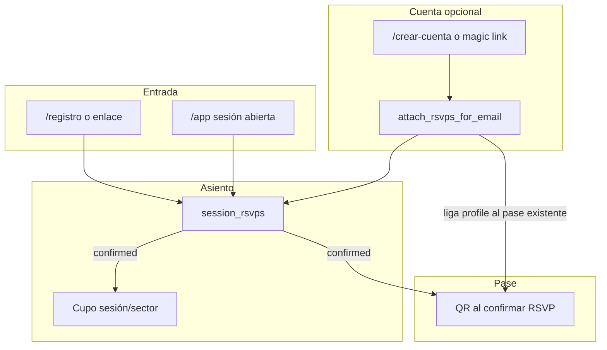

# Asistencia y cuenta estilo Luma — plan de reestructuración

> **For agentic workers:** implementar task-by-task. Cada archivo de código ≤ 90 líneas.

**Goal:** Separar **asiento en el evento** (RSVP por correo, multi-sesión, cupo al confirmar) de **cuenta Observatorio** (login / `/app` / diagnóstico). Al crear cuenta, enganchar RSVPs previos. Eliminar el embudo “crea cuenta para apartar / password inventado”.

**Architecture:** Nueva unidad `session_rsvps` (email + session). Cupo y conversiones leen RSVPs `confirmed`. CRM/org atribuyen origen; ya no son el gate del cupo. **Al confirmar el lugar se genera el QR del pase aunque no haya cuenta** (anclado al RSVP); si después crean cuenta, el pase se engancha al perfil.

**Tech stack:** Next.js App Router, Supabase SQL/RPC, Vitest, shadcn Alert/toast.

---

## Análisis de impacto (qué cambia y por qué)

### Invariantes que mueren

| Hoy | Luma |
|---|---|
| Sin cuenta onboarded no hay asiento | RSVP anónimo confirma y baja cupo |
| Admin/org “aceptar” baja cupo | Confirmación de RSVP baja cupo |
| 1 company ≤ 1 `session_id` | N RSVPs por email / N sesiones |
| 1 `public_registrations` por email (global) | Unique `(email, session_id)` |
| 1 pass / profile (exige cuenta) | 1 pass / RSVP (QR al confirmar, con o sin cuenta) |
| Conversion org = CRM aceptado + company | Conversion = RSVP confirmed (+ atribución org) |
| `awaitingApproval` bloquea producto | RSVP ya resolvió el lugar; cuenta es opcional |

### Por superficie

**1. Núcleo cupo** — `sector_occupied_ids`, `sector_is_full`, `sector_pace`, `attendance_cancellations`, `my_attendance_state`  
Hoy exigen empresa + onboarding + `admitted_at`/CRM. Deben contar RSVPs `confirmed` por `session_id` (y sector si hay quotas). Cancelación por sesión.

**2. Registro público** — `/registro`, `public_registrations`, `accept_public_registration`, pour, `RegistroDone`  
Hoy el form no baja cupo; accept crea auth+company+password. Luma: submit → RSVP (pending o confirmed según regla); accept **confirma asiento** sin inventar password; done **sin** CTA fuerte a `/crear-cuenta`.

**3. Crear cuenta / onboarding** — `/crear-cuenta`, signup, pour, `attribute_link_signup`  
Pasa a: crear acceso a la app + **attach RSVPs del email**. No es el paso del pase.

**4. CRM org + admin** — `approve_link_signup`, status `cargado→confirmo→registrado`, pases CRM  
Deja de ser el momento del cupo. Sigue siendo embudo de seguimiento / llegada. Atribución de RSVP al organismo vía token.

**5. Organismos** — copy link, home conversions, sector pace  
Conversiones deben contar RSVPs confirmed del enlace/sesión, no solo CRM+company. Pace por sesión del link.

**6. Tablero admin** — cupos KPIs, ocupados/pendientes, omitidos, logos  
“Ocupados” = RSVP confirmed. “Sin cuenta” = métrica aparte. Filtro por sesión sobre RSVPs.

**7. Mail / pases / mesa** — outbox, `passes`, arrivals  
Al **confirmar** RSVP: correo con **QR del pase** (sin cuenta). `passes` pasa a anclarse a `rsvp_id` (+ `session_id`); `profile_id` nullable hasta attach. Mesa escanea ese QR. Deuda `docs/deuda-tecnica-sesion-del-pase.md` se resuelve aquí.

**8. `/app`** — sesiones, attendance label, Unirme  
Claim por sesión; label por RSVP adjunto; multi-sesión.

**9. Empresas admin** — `approve_external_signup`, path pending  
Moderación de cuenta ≠ cupo. Redefinir o deprecar como gate de asiento.

---

## Decisiones fijas (no reabrir en implementación)

1. RSVP confirmed **descuenta cupo** (pending no, salvo hold explícito — no en v1).
2. Multi-sesión libre con el mismo email/cuenta.
3. Cuenta opcional; attach al signup/login con company.
4. **Al confirmar lugar → emitir QR de inmediato** (pase anclado al RSVP; no requiere `auth.users`).
5. Disruptors sin filas de cupo sectorial → tope `capacity_max`.
6. Con filas en `session_sector_quotas` → tope por sector en esa sesión.
7. `companies.session_id` = origen de alta (opcional); **no** inventario de asientos.
8. CRM “aceptar” ya no llama `sector_is_full` como gate principal (compat: no-op si RSVP ya confirmed).
9. **No se borra legacy:** no `DROP` de `public_registrations`, `companies`, `crm_*`, `passes`, `admitted_at`, ni perfiles. Se **añade** `session_rsvps` + backfill; lecturas nuevas prefieren RSVP; tablas viejas quedan hasta migrar lecturas.

---

## Garantías de legacy (no perder información)

| Dato actual | Qué pasa |
|---|---|
| `auth.users` / `profiles` / `companies` | Intactos. Nadie se recrea ni se apaga. |
| `admitted_at`, `sector_source` | Se conservan; dejan de ser la única fuente de cupo. |
| `companies.session_id` | Se conserva como origen; no se limpia en masa. |
| `public_registrations` | Se conserva; se **copia** a RSVPs. No delete en v1. |
| CRM contactos / eventos / status | Intactos; el embudo sigue. |
| `passes` / outbox / arrivals existentes | Se conservan; se les añade `rsvp_id`/`session_id` cuando se pueda mapear; filas viejas sin eso siguen legibles (“Sin sesión” ok). |
| `link_copies` / `link_opens` | Intactos. |
| Cancelaciones de asistencia | Se migran a por-sesión o se backfillean a la sesión conocida; no se pierden motivos. |

**Regla de deploy:** primero migrar + backfill + verificar conteos (registros ≈ RSVPs, admitidos ≈ confirmed). Solo después cambiar lecturas de cupo/UI. Si un conteo no cuadra, no se apaga el camino viejo.

**Verificación Task 2 (obligatoria antes de Task 3 en prod):**

- [ ] `count(public_registrations completed)` ≤ `count(session_rsvps)` mapeados (+ explicar huérfanos).
- [ ] `count(companies admitted)` vs RSVPs confirmed ligados (diff documentado).
- [ ] Spot-check 5 emails conocidos (p.ej. cuentas de prueba Disruptors/Arranque).

---

## Diagrama

---

## Task 0 — Spec corta + matriz de casos

**Files:** `docs/superpowers/specs/2026-11-22-asistencia-cuenta-luma-design.md`

- [x] Documentar matriz (nuevo, email-con-cuenta, logueado, enlace, cupo lleno, multi-evento, cancelar, attach).
- [x] Definir estados RSVP: `pending` | `confirmed` | `cancelled`.
- [x] Un solo mail de confirmación incluye el **QR del pase** (no esperar cuenta). Reenviar = mismo pase del RSVP.

---

## Task 1 — Tabla `session_rsvps` + RLS

**Files:**
- Create: `supabase/migrations/YYYYMMDDHHMMSS_session_rsvps.sql`

- [x] Columnas: `id`, `session_id`, `email` (citext/lower), `status`, `sector_id` nullable, `sector_slug`, `full_name`, `company_name`, `invite_token`, `organization_id` nullable, `profile_id` nullable, `company_id` nullable, `source`, `confirmed_at`, `cancelled_at`, timestamps.
- [x] Unique `(session_id, lower(email))`.
- [x] RLS: dueño por `profile_id = auth.uid()`; superadmin todo; insert público solo vía RPC.
- [x] Apply migration remota.

---

## Task 2 — Backfill desde datos actuales

**Files:** misma migración o `…_session_rsvps_backfill.sql`

- [ ] De `public_registrations` completed → RSVP por `session_id` (`pending` si no poured/accepted; `confirmed` si poured o accept histórico).
- [ ] De companies con `admitted_at` + `session_id` → RSVP confirmed ligado.
- [ ] Companies admitted + `session_id` null → RSVP Arranque si existe slug.
- [ ] Test SQL o script de conteos (no inventar emails).

---

## Task 3 — Cupo por sesión sobre RSVPs

**Files:**
- Create/replace: migration `session_rsvp_capacity.sql`
- Modify tests: `src/lib/cupo/sector-quota-sql.test.ts`, `seat-rules.test.ts`

- [ ] `private.session_confirmed_count(session_id, sector_id nullable)`.
- [ ] `private.session_is_full(session_id, sector_id nullable)` — con quotas usa sector; sin quotas usa `capacity_max`.
- [ ] Reemplazar usos de `sector_is_full` en accept/approve por variante con `session_id`.
- [ ] Mantener wrappers legacy solo si hacen falta para no romper deploy a medias (marcar deprecated).

---

## Task 4 — RPC `upsert_public_rsvp` + wire `/registro`

**Files:**
- Migration RPC
- Modify: `src/app/registro/actions.ts`, form/done
- Tests: registro actions / SQL

- [ ] Submit crea/actualiza RSVP `pending` (si requiere admin) o `confirmed` si política auto para sesión abierta sin revisión — **v1 Disruptors: `pending` hasta admin accept** (conservador) **o confirmed si `is_current` y sin org** — decidir en Task 0: default **pending + admin confirma** para no abrir flood; documentar.
- [ ] Default acordado en este plan: **registro público → `pending`; admin “Confirmar lugar” → `confirmed` + descuenta cupo**. Self-serve `/app` claim → `confirmed` directo si cuenta ya existía con historial aceptado.
- [ ] Unique email+session: idempotente.
- [ ] Nuevo flujo escribe `session_rsvps`; si aún se usa `public_registrations`, **también** se escribe ahí en dual-write hasta que admin lea solo RSVPs. **No drop** de la tabla en este plan.

---

## Task 5 — Admin registros = confirmar RSVP (no crear cuenta)

**Files:**
- Modify: `accept_public_registration` / nuevo `confirm_session_rsvp`
- Modify: `src/app/api/admin/registros/[id]/aceptar/route.ts`, UI accept
- Modify: list/map registros

- [ ] Botón “Confirmar lugar”: `pending` → `confirmed`, chequea cupo, **genera QR + mail con pase**.
- [ ] Si email ya tiene `company`/`profile`: attach `profile_id`/`company_id` al RSVP/pase; **no** raise `ya tiene cuenta`.
- [ ] Si no hay cuenta: **no** crear `auth.users` ni password; el pase vive en el RSVP.
- [ ] Copy UI: “Confirmar lugar” / “Reenviar pase”; no “Aceptar = crear cuenta”.
- [ ] Tests: email con company existente; sin cuenta + QR; cupo lleno; idempotente.

---

## Task 6 — UX anti-confusión registro / crear-cuenta

**Files:**
- Modify: `src/app/registro/registro-done.tsx`, `page.tsx`
- Modify: leads landing Disruptors si aplica

- [ ] Done: “Te llega el correo con tu lugar.” Sin CTA primario a `/crear-cuenta`.
- [ ] Link secundario: “¿Quieres el diagnóstico? Inicia sesión o crea acceso.”
- [ ] Si email ya registrado en auth al submit: respuesta `ya_tiene_cuenta` → UI “Inicia sesión para ver/apartar tus sesiones”.

---

## Task 7 — Attach al signup / login

**Files:**
- Migration: `attach_rsvps_for_email`
- Modify: `src/lib/auth/signup-empresario.ts`, `pour.ts`, `complete-empresario.ts`

- [ ] Tras crear company: RPC liga RSVPs del email a profile/company.
- [ ] **No re-emite QR** si el pase del RSVP ya existe; solo liga `profile_id` al pase.
- [ ] Si hubiera RSVP confirmed sin pase (datos viejos): emitir una vez.
- [ ] Pour legacy: si aún existe, solo attach; no duplicar company.

---

## Task 8 — Claim desde `/app`

**Files:**
- Migration: `claim_session_seat`
- Modify: `session-attendance.ts`, `[slug]/page.tsx`, action + toast
- Tests

- [ ] Requisitos: sesión `is_current`, usuario con company; si nunca fue aceptado históricamente, **v1: permitir claim solo si ya hay `admitted_at` OR ya tiene algún RSVP confirmed** (evitar cuentas spam); documentar.
- [ ] Insert RSVP confirmed + cupo; multi-sesión OK.
- [ ] UI: botón “Apartar lugar” / estado “Ya tienes lugar” / cupo lleno.

---

## Task 9 — Cancelación por sesión

**Files:**
- Migration: alterar `attendance_cancellations` o cancel en `session_rsvps`
- Modify: `cancel_my_attendance`, attendance-slot, onboarding

- [ ] Cancelar libera cupo de **esa** sesión.
- [ ] Otras sesiones intactas.
- [ ] `my_attendance_state(session_id)` o leer RSVP por slug.

---

## Task 10 — CRM: desacoplar cupo

**Files:**
- Modify: `approve_link_signup` SQL
- Modify: `src/lib/crm-actions.ts`, admin CRM route
- Tests: link-acceptance

- [ ] Approve CRM: si ya hay RSVP confirmed para esa sesión+email, solo avanza embudo; no bloquea por cupo de nuevo.
- [ ] Si no hay RSVP: crear/confirm RSVP al aprobar (compat lista excel/enlace viejo) **y** chequear cupo ahí.
- [ ] UI copy: “Aceptar en CRM” ≠ “dar de alta cuenta”.

---

## Task 11 — Atribución organismo en RSVP

**Files:**
- Modify: `attribute_link_signup` o nuevo `attribute_rsvp_invite`
- Modify: copy-link / registro con `invitacion`

- [ ] RSVP guarda `organization_id` / `invite_token` al registrarse con enlace.
- [ ] No exige `auth.uid()` para atribuir origen.
- [ ] Al attach, opcionalmente crea/actualiza `crm_contacts`.

---

## Task 12 — Conversiones organismo + pace

**Files:**
- Modify: `home-conversions.ts`, `link-conversions.ts`, `load-supabase-home.ts`
- Modify: `load-sector-pace.ts`, `load-sector-seats.ts`

- [ ] Conversion = RSVP `confirmed` con `organization_id` del org (y sesión del panel).
- [ ] Pace bars: filled desde RSVPs confirmed por sector/sesión.
- [ ] Tests de `link-stats` / conversions actualizados.

---

## Task 13 — Tablero admin cupos + KPIs

**Files:**
- Modify: `load-cupos.ts`, `sector-fill.ts`, `cupo-seat.ts`, `latest-logos.ts`, `session-contact-ids.ts`
- Modify: board copy (`reading.ts`) si cambia semántica

- [ ] Ocupados = RSVPs confirmed de la sesión.
- [ ] Pendientes = RSVPs pending (o “sin cuenta” = confirmed sin profile).
- [ ] Omitidos / fuera de lista según sector vs quotas.
- [ ] Tests snapshot/cupo.

---

## Task 14 — Pase QR anclado al RSVP (con o sin cuenta)

**Files:**
- Migration: `passes.rsvp_id` (+ `session_id`); `profile_id` nullable
- Modify: enqueue/send al confirmar; mesa/scan por rsvp/session
- Tests pases

- [ ] Al confirmar RSVP: crear pase + QR + correo (sin password, sin exigir cuenta).
- [ ] Unique: un pase por `rsvp_id` (o por `session_id`+email).
- [ ] Reenviar desde admin reusa el mismo QR.
- [ ] Attach cuenta: update `profile_id` en pase existente.
- [ ] Admin pases / mesa: filtrar por sesión; check-in sin login del asistente.

---

## Task 15 — Redefinir awaiting-approval / admitted_at

**Files:**
- Modify: `awaiting-approval.ts`, `session-hold.ts`, onboarding gates
- Modify: `approve_external_signup` usage

- [ ] No bloquear `/app` por “esperando org” si el producto es cuenta libre (ya parcialmente así).
- [ ] `admitted_at` = verificación de empresa para logo/eventuales privilegios; **no** cupo.
- [ ] Path pending admin: moderación, no asiento.

---

## Task 16 — Limpieza y deprecaciones

- [ ] Dejar de usar password temporal en accept.
- [ ] Documentar `public_registrations` vs `session_rsvps` (migración de lecturas admin).
- [ ] Actualizar `docs/deuda-tecnica-sesion-del-pase.md` cuando quede resuelto.
- [ ] AGENTS / notas breves si aplica.

---

## Task 17 — QA matriz E2E manual

- [ ] Nuevo email → registro → admin confirma → cupo −1 → **mail con QR sin cuenta** → crear cuenta → ve sesión en `/app` (mismo pase ligado).
- [ ] Mismo email → segunda sesión → segundo RSVP → cupo de esa sesión.
- [ ] Email con cuenta → registro → “inicia sesión” / claim.
- [ ] Logueado → Apartar en Disruptors → Ya tienes lugar; Arranque intacto.
- [ ] Cupo lleno → error claro.
- [ ] Org link → RSVP attributed → conversión en home.
- [ ] Cancelar una sesión → cupo libera; otra sesión ok.

---

## Orden de merge recomendado

1. Tasks 0–3 (modelo + cupo)  
2. Tasks 4–6 (registro + admin confirm + UX)  
3. Tasks 7–9 (cuenta + /app + cancel)  
4. Tasks 10–13 (CRM + org + tablero)  
5. Tasks 14–16 (mail/pases + cleanup)  
6. Task 17 QA  

PRs chicos por grupo; no un solo monstruo.

---

## Registro de avance (no borrar)

| Fecha | Bloque | Estado | Commit / notas |
|---|---|---|---|
| 2026-11-22 | Tasks 0–3 modelo+cupo | Hecho + remoto | `f12d624` — mig `500/501/502` (+400/410 Disruptors); backfill 101 confirmed |
| 2026-11-22 | Tasks 4–6 registro+admin+UX | Hecho + remoto | `8804081` — `510` sync/confirm; `541` attribute invite; QR mail |
| 2026-11-22 | Tasks 7–9 + 14 mesa | Hecho + remoto | `9ee857e` — `520` claim; `530` attach; `540` cancel+mesa; cancel UI solo onboarding |
| 2026-11-22 | Tasks 10–13 CRM+org+tablero | Hecho + remoto | `1e2485a` + `43f1912` — `542/544`; conversiones org; cupos admin RSVP |
| | Tasks 15–17 cleanup+QA | Pendiente | Deuda pase/session doc; QA E2E manual; cancel en `/app` |

**Dónde quedamos (HEAD `43f1912`):** núcleo Luma shipped en `develop` (ahead of origin). Gaps: cancel por sesión en `/app`, `sector_pace` organismo aún CRM, métrica “sin cuenta”, QA E2E Task 17.

---

## Fuera de alcance

- Redesign visual completo de CRM
- Check-in móvil nuevo
- Multi-company por profile
- `DROP` / purga de tablas legacy (`public_registrations`, columnas `admitted_at`, etc.)
- Plan viejo `2026-11-13-invitacion-sin-cuenta.md` (password oculta) — **superseded** por este; no implementar ese enfoque
